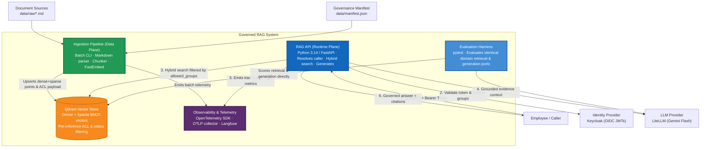

# RAG Architecture Guide

> **Reference architecture and implementation guide for governed, access-aware, and production-grade Retrieval-Augmented Generation (RAG) systems.**

Moving beyond naive proof-of-concept scripts, this repository demonstrates how to architect a complete enterprise RAG pipeline. It bridges the gap between basic vector search and a resilient production service by implementing document governance, hybrid retrieval, pre-inference security trimming, provider decoupling, and continuous evaluation gates.

---

## 🎯 The Motivation

A common failure mode in generative AI is treating RAG merely as connecting a vector database to an LLM. In enterprise scenarios, hallucinations, silent errors, and security breaches often stem from architectural gaps rather than model limitations:

1. **Ungoverned Document Ingestion:** Lack of data ownership, stale versions, and unstructured chunking.
2. **Semantic-Only Search Blind Spots:** Dense vector similarity struggles with exact codes, IDs, flags, and tabular structures.
3. **Context & Data Leakage:** Relying on the LLM to decide whether a user is authorized to see retrieved confidential data.
4. **Monolithic Evaluations & Coupling:** Tightly coupling business logic to specific vector databases, embedding providers, or frameworks without clear domain boundaries.

This repository implements the solutions to these challenges across three architectural planes following **Clean Hexagonal Architecture (Ports & Adapters)** and **CQRS**.

---

## 🏗️ Architectural Overview



### Architectural Planes

* **Data Plane (Offline Batch Ingestion):** Ingests raw markdown documents, validates them against strict governance manifests, drops archived versions, preserves table syntax intact, calculates dual representations (dense ONNX + sparse BM25), and persists points with security metadata into Qdrant.
* **Runtime Plane (Query Orchestration):** Resolves caller identity and group memberships from OIDC bearer tokens. Executes hybrid vector search with deterministic pre-inference security trimming (only evidence matching caller groups is returned) before calling LiteLLM in-process.
* **Control & Quality Plane:** Automated quality gates enforcing architectural boundaries via `import-linter`, contract testing, and evaluation suites (`dev_set`, `val_set`, `protected_set`).

---

## 🛠️ Technology Stack

| Concern | Technology | ADR Reference |
| :--- | :--- | :--- |
| **Language & Environment** | Python 3.14 (pinned) via `uv` | [ADR 0001](docs/adr/0001-python-as-primary-language.md), [ADR 0002](docs/adr/0002-uv-for-dependencies-and-environments.md) |
| **Domain Modeling** | Pydantic v2 + `abc.ABC` behavioral ports | [ADR 0003](docs/adr/0003-shared-domain-contracts-and-boundaries.md), [ADR 0004](docs/adr/0004-strict-domain-modeling-and-validation-in-python.md) |
| **Embeddings** | FastEmbed (in-process ONNX dense + sparse BM25) | [ADR 0005](docs/adr/0005-preprocessing-and-embeddings.md) |
| **Vector Storage** | Qdrant (Hybrid dense + sparse, payload filtering) | [ADR 0006](docs/adr/0006-qdrant-for-hybrid-retrieval.md) |
| **API Runtime** | FastAPI (stateless, OpenAPI contract-first) | [ADR 0007](docs/adr/0007-api-orchestration-and-http-contract.md) |
| **LLM Gateway** | LiteLLM in-process (Google AI Studio Gemini Flash) | [ADR 0008](docs/adr/0008-llm-provider-and-gateway.md) |
| **Identity & Access** | OIDC Bearer tokens (Keycloak for local/CI) | [ADR 0009](docs/adr/0009-runtime-security-and-trust-boundaries.md), [ADR 0010](docs/adr/0010-identity-provider-and-oidc-token-validation.md) |
| **Observability** | OpenTelemetry SDK + OTLP + Langfuse | [ADR 0011](docs/adr/0011-observability-baseline-and-telemetry-contract.md), [ADR 0012](docs/adr/0012-telemetry-pipeline-and-backends.md), [ADR 0013](docs/adr/0013-ai-observability-and-prompt-governance.md) |
| **Evaluation Gates** | Multi-gate policy (`dev_set`, `val_set`, `protected_set`) | [ADR 0014](docs/adr/0014-evaluation-governance-and-quality-gates.md), [ADR 0015](docs/adr/0015-evaluation-stack-and-tooling-boundaries.md) |
| **CI Platform** | Jenkins fail-fast delivery pipeline | [ADR 0016](docs/adr/0016-jenkins-ci-platform-and-pipeline-implementation.md) |
| **Deployment** | Multi-stage Docker containers + Compose | [ADR 0017](docs/adr/0017-local-deployment-and-container-packaging.md) |

---

## 🚀 Quickstart & Quality Gates

### 1. Run Automated Quality Gates
Validate static formatting, typing, architectural boundaries, and test suites in a single command:
```bash
bash scripts/check.sh
```

### 2. Execute Containerized Ingestion
Run the complete Data Plane ingestion vertical slice via Docker Compose:
```bash
docker compose -f docker/docker-compose.yml run --rm ingestion
```
For complete step-by-step local validation, see the [Quickstart Guide](specs/001-document-ingestion/quickstart.md).

---

## 📂 Repository Structure

```text
├── data/                  # Source documents (data/raw/) and governance manifest (data/manifest.json)
├── src/
│   ├── domain/            # Pure business entities, enums, and abstract behavioral ports
│   │   ├── models.py      # GovernedChunk, VectorizedChunk, CanonicalDocument
│   │   ├── manifest.py    # In-memory manifest validation and lifecycle filtering
│   │   └── ports/         # Outbound behavioral ports (EmbedderPort, ChunkStorageWriterPort)
│   ├── adapters/          # Concrete infrastructure implementations
│   │   ├── embeddings/    # FastEmbed adapter (dense + sparse BM25)
│   │   ├── storage/       # Qdrant adapter with collection contracts and payload indexers
│   │   └── telemetry/     # OpenTelemetry manager and lifecycle flusher
│   └── ingestion/         # Batch data plane pipeline and CLI entrypoint
│       ├── pipeline.py    # Use case orchestrator (run_ingestion_pipeline)
│       ├── chunker.py     # Table-preserving Markdown chunker
│       ├── parser.py      # Frontmatter extractor
│       └── cli.py         # Composition Root for batch document ingestion
├── docs/
│   ├── adr/               # Architectural Decision Records (ADRs 0001–0017)
│   ├── diagrams/          # C4 system diagrams, container views, and sequence flows
│   └── notes/             # Foundation design notes (governance metadata, evaluation-first)
├── specs/                 # Feature specifications, data models, and actionable task lists
├── tests/                 # Unit, architectural contract, and integration test suites
├── evals/                 # Evaluation suites (dev_set.json, val_set.json) and metrics
└── docker/                # Multi-stage Docker packaging
```
