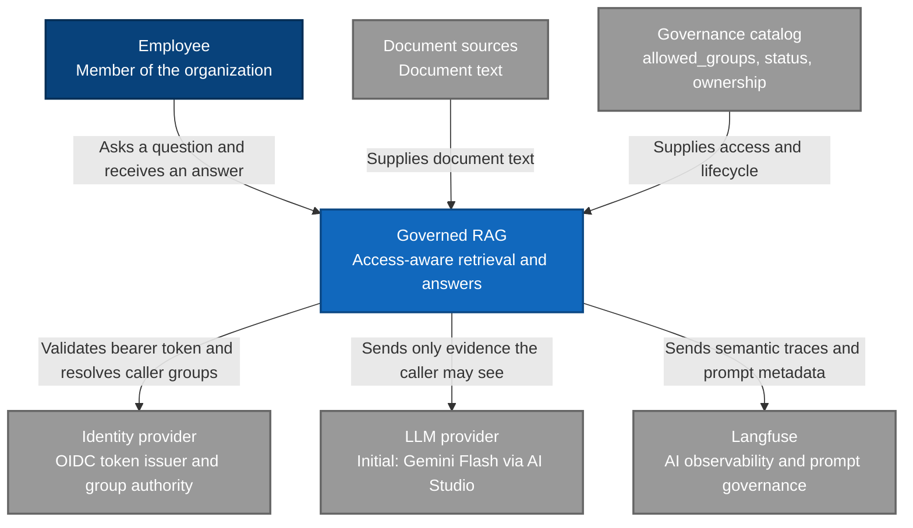

# System context

C4 level 1. The governed RAG is the system being built. People and external systems sit outside it. The evaluation harness is inside the system, so it does not appear here.

Access is granted by groups. Document text and governance arrive from different places. In this repository those places are `data/raw/` and `data/manifest.json`. Generation uses LiteLLM in-process with Gemini Flash as the initial provider (ADR 0008). AI-semantic traces and prompt governance are handled by Langfuse (ADR 0013).

