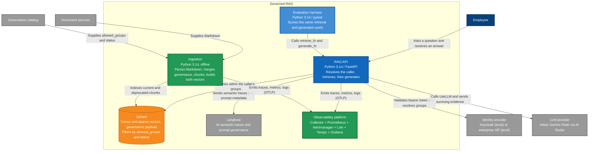

# Containers

C4 level 2. These are the processes and data stores inside the governed RAG from the context diagram. People and external systems stay outside the boundary.

FastAPI is the decided HTTP runtime. Retrieval has two channels, and both live in Qdrant (ADR 0006). The dense vector finds a chunk by meaning. The sparse vector finds a written token, such as an option name, a flag, or an identifier. Stemming and the rest of the lexical analysis run in Python before a point is written (ADR 0005). Generation uses LiteLLM as an in-process library inside the API (ADR 0008). System observability follows ADR 0011 and ADR 0012: API and ingestion emit OTLP telemetry to an observability platform. Detailed telemetry internals are documented in diagram 08. There is no web UI in this system. The evaluation harness calls the same retrieval and generation ports as the API. It does not go through HTTP.

Ingestion reads document text and the governance catalog. It does not read the identity provider. Each chunk becomes one Qdrant point: dense vector, sparse vector, and governance payload. `deprecated` documents stay in the collection. `archived` documents are left out. The API validates bearer tokens and resolves groups from token claims. Qdrant applies that intersection, together with the lifecycle filter, before it returns candidates.

