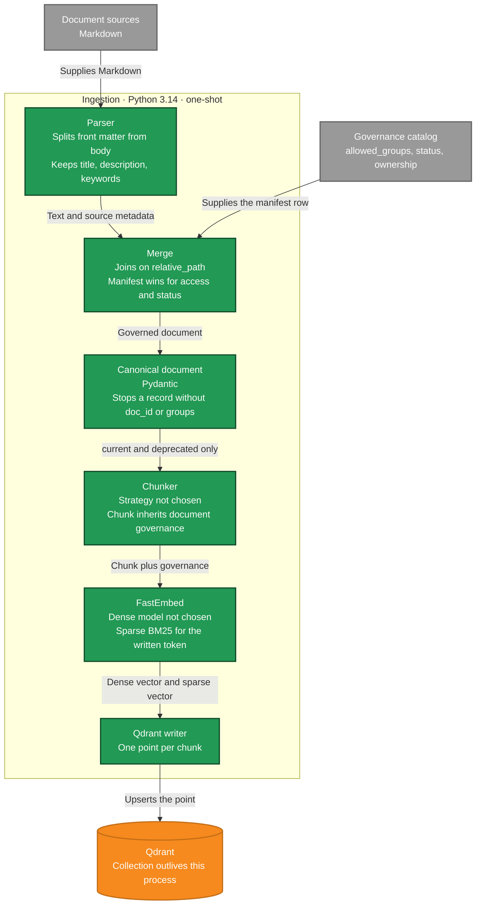

# Ingestion components

C4 level 3, inside the ingestion container from the container diagram. The process is one-shot (ADR 0005). It starts, runs the components below, flushes its telemetry, and exits. Qdrant stays up. The collection outlives the process.

The parser reads Markdown and does not know groups. The merge joins a file to its manifest row by `relative_path`. For access and status, the manifest wins. A document that fails validation does not continue. `archived` documents are dropped after validation. `current` and `deprecated` are chunked. The chunk strategy is not chosen. Each chunk inherits its document's governance.

FastEmbed builds both vectors before the write. The dense model is not chosen. The sparse vector is BM25, for a written token such as an option name, a flag, or an identifier. The writer upserts one Qdrant point per chunk: dense vector, sparse vector, and governance payload. The model name and the dimensions are recorded with the collection. Ingestion does not read the identity provider.

