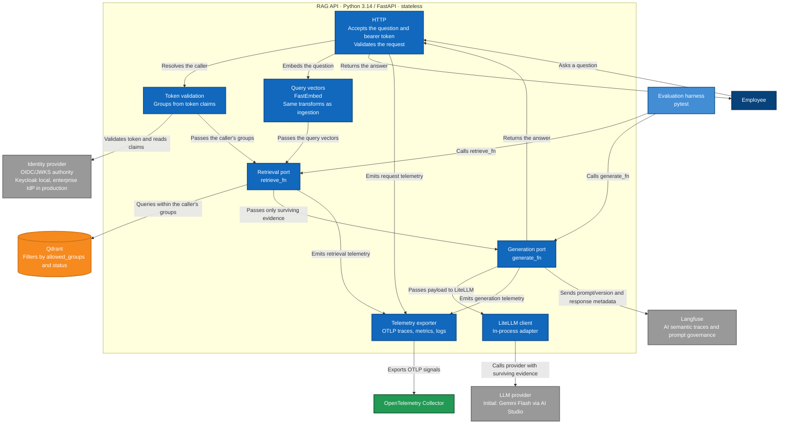

# API components

C4 level 3, inside the RAG API container from the container diagram. The process is stateless. It accepts a question plus `Authorization: Bearer <token>`, and it returns an answer. The caller does not send their groups.

FastAPI is the HTTP boundary where input is validated. Group resolution, retrieval, and generation sit behind it. The evaluation harness calls the retrieval and generation ports directly without going through HTTP.

The query is embedded with FastEmbed, with the same transforms ingestion used for a query (ADR 0005). Retrieval passes the caller's groups to Qdrant. Qdrant applies that intersection, and the lifecycle filter, before it returns candidates (ADR 0006). Generation sees only that evidence. The generation adapter uses LiteLLM in-process and calls Gemini Flash as the initial provider (ADR 0008). API components emit OTLP telemetry through an exporter component toward the OpenTelemetry Collector (ADR 0011 and ADR 0012).

The ports are `retrieve_fn(query, user_id, top_k=3)` and `generate_fn(query, context_doc_ids, user_id)`. They are `abc.ABC` implementations. The data that crosses them is a Pydantic model (ADR 0004).

---

## 1. Core query pipeline (functional view)

This view shows the linear sequence of internal processing stages when a query is executed, isolating the business flow from auxiliary telemetry sinks and harness infrastructure.

```mermaid
graph LR
  User["Employee<br/>POST /query"] --> HTTP["1. HTTP boundary<br/>FastAPI / Pydantic<br/>Validates schema"]
  HTTP --> Identity["2. Identity resolution<br/>Validates OIDC token<br/>Resolves user groups"]
  Identity --> Vectors["3. Query vectorization<br/>FastEmbed: Dense + BM25<br/>Matches ingestion transforms"]
  Vectors --> Retrieve["4. Retrieval port<br/>retrieve_fn<br/>Hybrid search & security trimming"]
  Retrieve --> Prompt["5. Context isolation<br/>Encloses evidence in markers<br/>Prevents prompt injection"]
  Prompt --> Generate["6. Generation port<br/>generate_fn<br/>LiteLLM / Gemini Flash"]
  Generate --> Response["7. Typed response<br/>ground_answer, deny_access,<br/>abstain, or clarify"]

  style HTTP fill:#229954,stroke:#114d2a,color:#ffffff,stroke-width:2px
  style Identity fill:#229954,stroke:#114d2a,color:#ffffff,stroke-width:2px
  style Vectors fill:#229954,stroke:#114d2a,color:#ffffff,stroke-width:2px
  style Retrieve fill:#229954,stroke:#114d2a,color:#ffffff,stroke-width:2px
  style Prompt fill:#229954,stroke:#114d2a,color:#ffffff,stroke-width:2px
  style Generate fill:#229954,stroke:#114d2a,color:#ffffff,stroke-width:2px
  style User fill:#08427b,stroke:#052e56,color:#ffffff,stroke-width:2px
  style Response fill:#08427b,stroke:#052e56,color:#ffffff,stroke-width:2px
```

---

## 2. Component and integration topology (structural view)

This view shows all internal components alongside external systems, identity authorities, data stores, evaluation entry points, and observability sinks (ADR 0005–ADR 0013).

