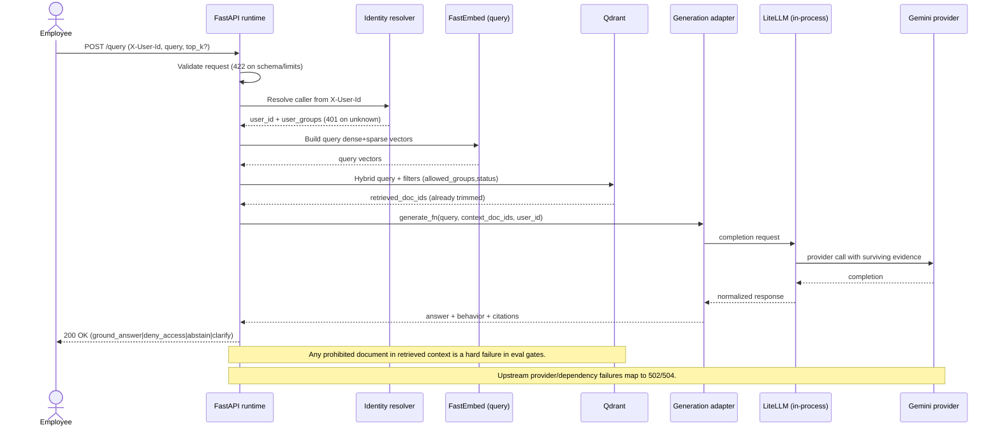

# Runtime query sequence

Sequence view for one interactive query. This diagram complements container/component views by
showing execution order and security gates from ADR 0007, ADR 0008, and ADR 0009.

The caller sends `X-User-Id` and query text. The API validates input, resolves caller groups, and
builds query vectors. Qdrant applies `allowed_groups` and lifecycle status filters before returning
candidates. Generation uses only that surviving evidence through LiteLLM to Gemini.

