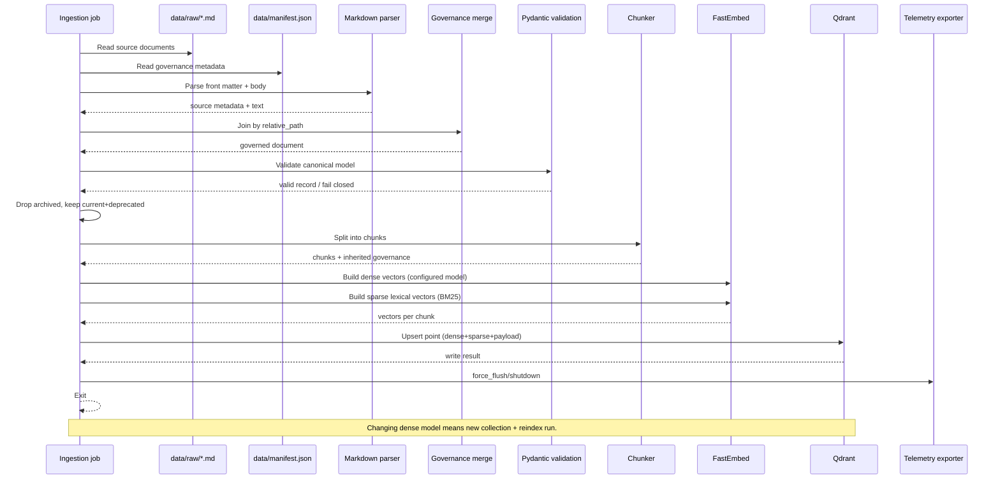

# Ingestion sequence

Sequence view for one ingestion run. This is a one-shot Data Plane job from ADR 0005. The process
starts, writes/upserts points, flushes telemetry exporters, and exits. Qdrant stays up.

