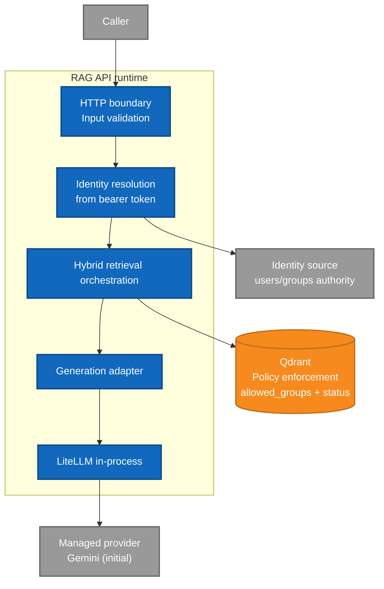

# Security boundary view

Trust-boundary view for runtime security from ADR 0009. It highlights which component is authority
for identity, which component enforces document-level access, and where external-provider exposure
starts.

Security invariants:

- Identity authority is bearer-token validation, not caller-supplied groups.
- Access control is deterministic at retrieval time, before generation.
- Generation only receives already-trimmed evidence.
- Provider exposure starts only after security trimming.
