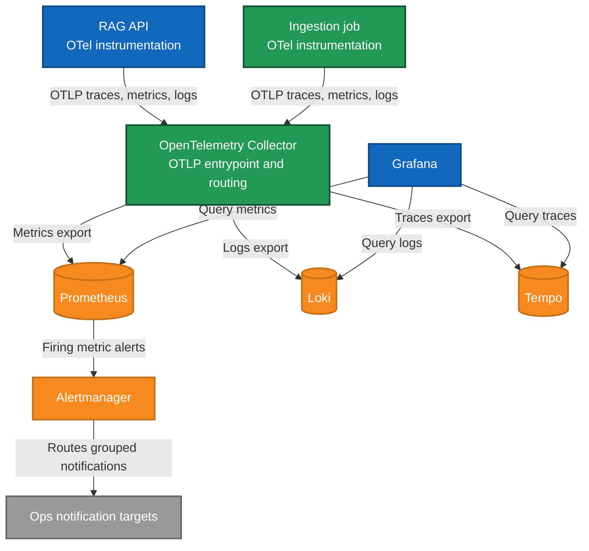

# Observability telemetry flow

Operational telemetry flow from ADR 0011 and ADR 0012.

Runtime and ingestion both emit OTLP signals to the OpenTelemetry Collector. The collector routes
metrics to Prometheus, logs to Loki, and traces to Tempo. Prometheus sends firing metric alerts to Alertmanager. Grafana reads from Prometheus, Loki, and Tempo.

Notes:

- Ingestion is ephemeral and must call exporter `force_flush()/shutdown()` before exit.
- Correlation IDs (`trace_id`, `span_id`, `request_id` or `run_id`) are required for joins.
