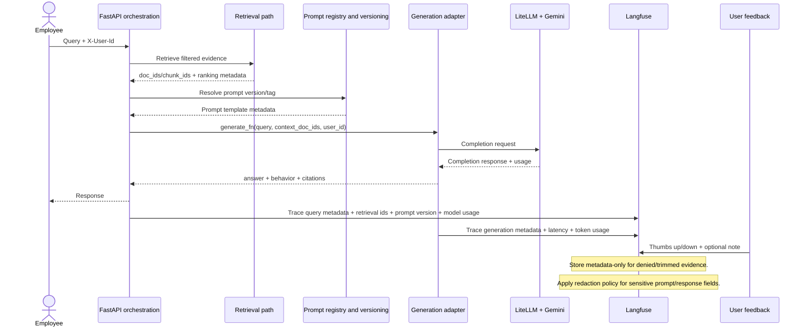

# AI observability and prompt governance flow

Semantic AI tracing and prompt-governance flow from ADR 0012.

Captured dimensions:

- Query and correlation identifiers
- Retrieval identifiers and ranking metadata
- Prompt version/tag and release stage
- Provider/model/latency/token usage
- Output behavior classification and user feedback
