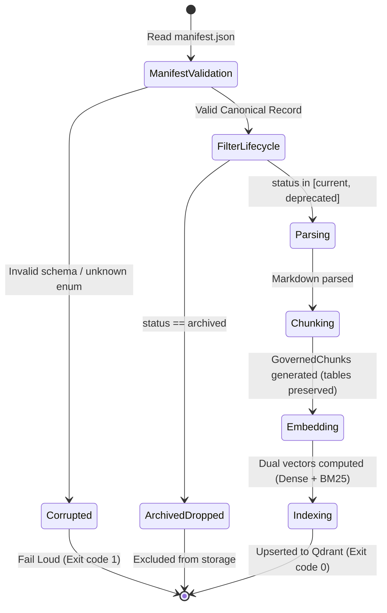

# Data Model Specification: Governed Document Ingestion Pipeline

**Feature**: `001-document-ingestion`  
**Date**: 2026-11-05  
**Status**: Completed  

---

## 1. Closed Governance Catalogs (Domain Enums)

All classification and security taxonomies are strictly closed catalogs defined as standard Python `StrEnum` classes. Any value outside these enumerations is rejected at validation boundaries.

```python
from enum import StrEnum


class Department(StrEnum):
    """Owning department of the document. Does not grant access on its own."""

    HR = "HR"
    ENGINEERING = "Engineering"
    SECURITY = "Security"
    FINANCE = "Finance"
    LEGAL = "Legal"


class Classification(StrEnum):
    """Sensitivity classification of the document. Does not grant access on its own."""

    PUBLIC = "public"
    INTERNAL = "internal"
    RESTRICTED = "restricted"


class LifecycleStatus(StrEnum):
    """Document lifecycle state governing indexing and freshness."""

    CURRENT = "current"  # Indexed; primary grounding evidence
    DEPRECATED = "deprecated"  # Indexed; historical context, superseded by current
    ARCHIVED = "archived"  # Excluded from indexing completely


class IdPGroup(StrEnum):
    """Identity provider groups that cross the access boundary."""

    ALL_EMPLOYEES = "all-employees"
    PEOPLE_TEAM = "people-team"
    ENGINEERING_CORE = "engineering-core"
    SECURITY_ONCALL = "security-oncall"
    LEADERSHIP = "leadership"
```

---

## 2. Core Domain Entities

### 2.1 Manifest Record (`ManifestRecord`)
Represents an individual entry in `data/manifest.json`.

| Field | Type | Required | Description & Validation Rules |
| :--- | :--- | :---: | :--- |
| `doc_id` | `str` | Yes | Unique business identifier (e.g., `DOC-HR-001`, `DOC-ENG-002`). Regex: `^DOC-[A-Z]{2,4}-[0-9]{3}$`. |
| `relative_path` | `str` | Yes | Path relative to `data/raw/` (e.g., `docker/bridge.md`). Must correspond to an existing `.md` file. |
| `department` | `Department` | Yes | Must belong to closed catalog `Department`. |
| `allowed_groups` | `list[IdPGroup]` | Yes | Non-empty list of groups authorized to read this document. Must be valid `IdPGroup` values. |
| `classification` | `Classification` | Yes | Must belong to closed catalog `Classification`. |
| `status` | `LifecycleStatus` | Yes | Must belong to closed catalog `LifecycleStatus`. |

---

### 2.2 Canonical Document (`CanonicalDocument`)
Represents the merged, validated enterprise document ready for chunking.

```python
from pydantic import BaseModel, ConfigDict, Field


class CanonicalDocument(BaseModel):
    doc_id: str = Field(description="Unique corporate document ID")
    relative_path: str = Field(description="Relative file path in corpus")
    department: Department = Field(description="Owning department")
    allowed_groups: list[IdPGroup] = Field(min_length=1, description="Authorized IdP groups")
    classification: Classification = Field(description="Sensitivity classification")
    status: LifecycleStatus = Field(description="Lifecycle status")
    title: str = Field(description="Extracted from frontmatter or first markdown heading")
    content: str = Field(description="Markdown body without frontmatter")
    keywords: list[str] = Field(default_factory=list, description="Extracted tags/keywords")

    model_config = ConfigDict(extra="forbid")
```

---

### 2.3 Governed Chunk (`GovernedChunk`)
An indivisible segment of text that inherits its parent document's governance metadata.

```python
class GovernedChunk(BaseModel):
    chunk_id: str = Field(description="Deterministic ID: {doc_id}#c{chunk_index}")
    doc_id: str = Field(description="Parent document identifier")
    allowed_groups: list[IdPGroup] = Field(min_length=1, description="Inherited access groups")
    status: LifecycleStatus = Field(description="Inherited lifecycle status")
    department: Department = Field(description="Inherited owning department")
    classification: Classification = Field(description="Inherited classification")
    chunk_index: int = Field(ge=0, description="Sequential 0-indexed position within doc")
    text: str = Field(description="Raw chunk text preserving Markdown structure and tables")
    is_tabular: bool = Field(default=False, description="True if chunk contains a table")

    model_config = ConfigDict(extra="forbid")
```

---

### 2.4 Vectorized Chunk (`VectorizedChunk`)
The enriched chunk containing dual vector embeddings prepared for Qdrant upsert.

```python
class VectorizedChunk(BaseModel):
    chunk: GovernedChunk = Field(description="The underlying governed chunk")
    dense_vector: list[float] = Field(description="Dense semantic embedding vector")
    sparse_indices: list[int] = Field(description="Sparse lexical token indices")
    sparse_values: list[float] = Field(description="Sparse lexical token weights")

    model_config = ConfigDict(extra="forbid")
```

---

## 3. Storage Model (Qdrant Point Struct)

Each `VectorizedChunk` maps to a Qdrant point struct as follows:

```json
{
  "id": "e4d909c2-9012-4c2f-b44a-9528f11ec438", 
  "vector": {
    "dense": [0.0123, -0.0456, "... (1024 floats) ..."],
    "sparse": {
      "indices": [45, 1204, 8932],
      "values": [1.45, 0.82, 2.11]
    }
  },
  "payload": {
    "chunk_id": "DOC-HR-001#c0",
    "doc_id": "DOC-HR-001",
    "allowed_groups": ["all-employees"],
    "status": "current",
    "department": "HR",
    "classification": "internal",
    "chunk_index": 0,
    "text": "### Remote Work Policy\nEmployees are eligible for remote work...",
    "is_tabular": false
  }
}
```

---

## 4. Entity State Transitions



