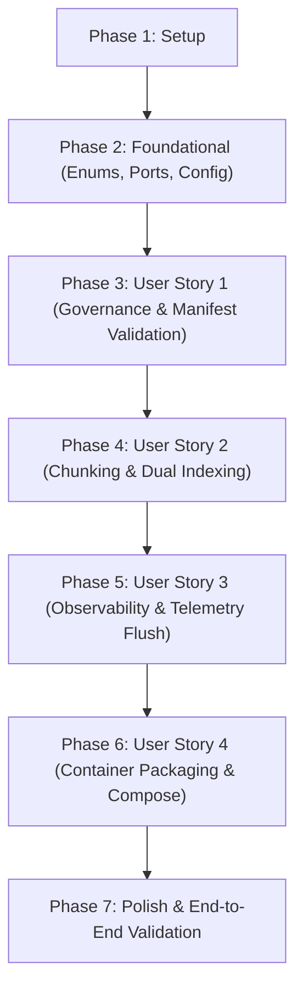

# Tasks: Governed Document Ingestion Pipeline

**Input**: Design documents from `/specs/001-document-ingestion/`
**Prerequisites**: [plan.md](plan.md), [spec.md](spec.md), [research.md](research.md), [data-model.md](data-model.md), [contracts/](contracts/)
**Constitution Compliance**: Enforces Constitution v2.0.0 (Articles 1-16), including hexagonal architecture, composition roots, test-first development, zero-trust trimming, dual-vector indexing, zero telemetry loss, and container packaging.

## Format: `[ID] [P?] [Story] Description`

- **[P]**: Can run in parallel (different files, no dependencies on incomplete tasks)
- **[Story]**: Which user story this task belongs to (e.g., `[US1]`, `[US2]`, `[US3]`, `[US4]`)
- Include exact file paths in descriptions

---

## Phase 1: Setup (Shared Infrastructure)

**Purpose**: Project initialization, dependency management, and architecture validation tooling

- [X] T001 Configure project dependencies in `pyproject.toml` using uv and lock with `uv.lock`
- [X] T002 [P] Create directory structure: `src/domain/ports/`, `src/adapters/embeddings/`, `src/adapters/storage/`, `src/adapters/telemetry/`, `src/ingestion/`, `tests/unit/`, `tests/contract/`, `tests/integration/`, and `docker/`
- [X] T003 [P] Configure architectural boundary enforcement in `.importlinter` ensuring `src.domain` has zero imports from `src.adapters`, `src.ingestion`, or third-party storage libraries

---

## Phase 2: Foundational (Blocking Prerequisites)

**Purpose**: Core domain contracts, ports, and configuration that MUST be complete before ANY user story can be implemented

**⚠️ CRITICAL**: No user story work can begin until this phase is complete.

- [X] T004 [P] Define closed governance catalog enums in `src/domain/enums.py` (`Department`, `Classification`, `LifecycleStatus`, `IdPGroup`) per `data-model.md`
- [X] T005 [P] Define abstract behavioral ports in `src/domain/ports/embeddings.py` (`EmbedderPort`) and `src/domain/ports/storage.py` (`ChunkStorageWriterPort`)
- [X] T006 [P] Define environment and pipeline configuration model in `src/ingestion/config.py` using `pydantic_settings.BaseSettings` per `contracts/ingestion-cli.md`
- [X] T007 [P] Implement architectural contract test in `tests/contract/test_architecture_contracts.py` enforcing domain isolation and adapter inheritance

**Checkpoint**: Foundation ready - domain models, ports, and configuration initialized. User story implementation can now begin.

---

## Phase 3: User Story 1 - Enforce Governance and Manifest Access Rules (Priority: P1) 🎯 MVP

**Goal**: Validate manifest records against closed governance catalogs, fail loud on invalid records or uncataloged files, drop `archived` documents, and produce canonical documents retaining `current` and `deprecated` metadata.

**Independent Test**: Run validation stage against valid, malformed, and out-of-catalog manifest records; verify valid documents proceed, invalid fail loud, and archived documents are completely excluded.

### Tests for User Story 1 (Test-First)

- [X] T008 [P] [US1] Create unit tests for domain enums, models, and boundary validation in `tests/unit/test_domain_models.py`
- [X] T009 [P] [US1] Create contract test for `data/manifest.json` in `tests/contract/test_manifest_contract.py` validating schema against disk corpus
- [X] T010 [P] [US1] Create unit tests for manifest parsing and fail-loud validation in `tests/unit/test_manifest_validation.py`
- [X] T011 [P] [US1] Create unit tests for Markdown frontmatter parsing and body extraction in `tests/unit/test_markdown_parser.py`
- [X] T012 [P] [US1] Implement `ManifestRecord` and `CanonicalDocument` models in `src/domain/models.py` per `data-model.md`
- [X] T013 [US1] Implement in-memory manifest validator in `src/domain/manifest.py` and loader in `src/ingestion/manifest_loader.py` enforcing active/archived partitioning (depends on T012)
- [X] T014 [US1] Implement Markdown parser in `src/ingestion/parser.py` extracting frontmatter and constructing `CanonicalDocument` instances (depends on T012, T013)

**Checkpoint**: User Story 1 complete and independently testable. Run `uv run pytest tests/unit/test_domain_models.py tests/unit/test_manifest_validation.py tests/unit/test_markdown_parser.py tests/contract/test_manifest_contract.py`.

---

## Phase 4: User Story 2 - Structure-Preserving Chunking & Dual-Representation Indexing (Priority: P1)

**Goal**: Chunk Markdown content preserving tables intact (repeating headers on oversized row splits), attach inherited governance metadata (`doc_id`, `allowed_groups`, `status`) to all chunks, generate dual representations (dense ONNX embeddings + sparse BM25 token weights), and upsert points to Qdrant collection `governed_docs`.

**Independent Test**: Run chunker and indexing engine against Markdown documents containing complex tables and technical flags; verify table rows preserve header context, chunks inherit parent governance metadata, and both dense and sparse vectors are stored with payloads in Qdrant.

### Tests for User Story 2 (Test-First)

- [X] T015 [P] [US2] Create unit tests for table-preserving chunking in `tests/unit/test_table_chunker.py` verifying strategy contract conformance, intact table preservation, oversized table splitting with repeated headers, fenced code block pipe protection, pure prose sequential reading order, and empty/whitespace document handling
- [X] T016 [P] [US2] Create integration tests for FastEmbed adapter in `tests/integration/test_fastembed_adapter.py` using module-scoped embedder fixture, verifying dense vector generation, sparse BM25 indices/values, dimension consistency, and `vectorize_chunks` GovernedChunk enrichment
- [X] T017 [P] [US2] Create integration tests for Qdrant storage adapter in `tests/integration/test_qdrant_writer.py` using embedded in-memory Qdrant (`:memory:`) verifying port conformance, collection initialization idempotency, dual-vector upsert, and payload retrieval by `allowed_groups` and `status`

### Implementation for User Story 2

- [X] T018 [P] [US2] Implement `GovernedChunk` and `VectorizedChunk` models in `src/domain/models.py` per `data-model.md`
- [X] T019 [US2] Implement strategy contract `DocumentChunker` and default `TablePreservingChunker` in `src/ingestion/chunker.py` identifying Markdown table blocks (`| ... |`), preserving tables intact within token budgets, splitting oversized tables across rows with repeated headers, segmenting standard prose across paragraph boundaries, and assigning inherited governance metadata to each `GovernedChunk` (depends on T018)
- [X] T020 [US2] Implement `FastEmbedAdapter` inheriting from `EmbedderPort` in `src/adapters/embeddings/fastembed_adapter.py` using `fastembed` TextEmbedding (`BAAI/bge-large-en-v1.5`, 1024 dims) and SparseTextEmbedding (`Qdrant/bm25`) to produce `VectorizedChunk` instances (depends on T005, T018)
- [X] T021 [US2] Implement `QdrantStorageAdapter` inheriting from `ChunkStorageWriterPort` in `src/adapters/storage/qdrant_adapter.py` creating the collection per `contracts/qdrant-collection.json` with named vectors (`dense` 1024 Cosine, `sparse` idf) and payload keyword indexes (`doc_id`, `allowed_groups`, `status`, `department`, `classification`), and batch upserting points with governance payloads (depends on T005, T018)
- [X] T022 [US2] Integrate parsing, pluggable chunking (`DocumentChunker`), embedding, and storage indexing via dependency injection in `src/ingestion/pipeline.py` to process active canonical documents into Qdrant (depends on T014, T019, T020, T021)

**Checkpoint**: User Stories 1 and 2 complete and independently testable. Run `uv run pytest tests/unit/test_table_chunker.py tests/integration/test_fastembed_adapter.py tests/integration/test_qdrant_writer.py`.

---

## Phase 5: User Story 3 - Spec-Driven Batch Observability & Telemetry Flush (Priority: P2)

**Goal**: Emit structured JSON logs on stdout with `run_id`, stage spans (`ingestion.run`, `ingestion.manifest.validate`, `ingestion.document.parse`, `ingestion.document.chunk`, `ingestion.embeddings.compute`, `ingestion.storage.upsert`), progress counters, scrub confidential content, and guarantee explicit telemetry flush before termination.

**Independent Test**: Execute batch run with telemetry listener or stdout inspection; confirm structured JSON logs carry `run_id`, all stage spans close, counters match processed totals, and exporters flush cleanly prior to process exit code 0 (or non-zero on error).

### Tests for User Story 3 (Test-First)

- [X] T023 [P] [US3] Create unit tests for structured JSON logging, sensitive data scrubbing, and telemetry lifecycle in `tests/unit/test_telemetry.py`
- [X] T024 [P] [US3] Create integration tests for OTel tracer, stage spans, structured logging, and flush lifecycle in `tests/integration/test_telemetry_flush.py`

### Implementation for User Story 3

- [X] T025 [P] [US3] Implement OpenTelemetry adapter and structured JSON log formatter in `src/adapters/telemetry/otel_emitter.py` generating a unique `run_id`, initializing `TracerProvider` with stage spans, `MeterProvider` with progress counters, and explicit `flush_and_shutdown()`
- [X] T026 [US3] Integrate stage spans and metric counters into `src/ingestion/pipeline.py` wrapping manifest validation, parsing, chunking, embedding, and storage upsert within child spans of root span `ingestion.run` (depends on T022, T025)
- [X] T027 [US3] Implement CLI composition root entrypoint, exit code handling (0-4), and guaranteed `finally` telemetry flush in `src/ingestion/cli.py` per `contracts/ingestion-cli.md` (depends on T025, T026)

**Checkpoint**: User Story 3 complete. Batch execution logs structured JSON with `run_id` and flushes all spans/metrics before process termination.

---

## Phase 6: User Story 4 - Single-Command Containerized Deployment (Priority: P3)

**Goal**: Package the ingestion pipeline into a multi-stage container image (`docker/Dockerfile.ingestion`), excluding build tools (`uv`) from the runtime image, and orchestrate with Qdrant via `docker/docker-compose.yml` so that a single command starts Qdrant, executes one-shot ingestion, and exits with code 0.

**Independent Test**: Execute container orchestration command in a clean environment; verify storage starts, one-shot ingestion container runs to completion, populates collection, and exits with code 0 while Qdrant remains healthy.

### Tests for User Story 4 (Test-First)

- [X] T028 [P] [US4] Create end-to-end integration test in `tests/integration/test_ingestion_e2e.py` executing complete batch pipeline with real FastEmbedAdapter and in-memory Qdrant, validating point counts, dual vector shapes, and zero archived documents

### Implementation for User Story 4

- [X] T029 [P] [US4] Create multi-stage containerfile in `docker/Dockerfile.ingestion` with builder stage running `uv sync --frozen --no-dev` and lean runtime stage based on `python:3.14-slim`
- [X] T030 [US4] Create container orchestration in `docker/docker-compose.yml` declaring Qdrant service with healthcheck and one-shot `ingestion` service mounting `data/` and passing environment variables per `contracts/ingestion-cli.md`
- [X] T031 [US4] Validate containerized batch execution and zero-archived count against running Qdrant service following `specs/001-document-ingestion/quickstart.md` (depends on T029, T030)

**Checkpoint**: User Story 4 complete. Full stack runs reproducibly via `docker compose -f docker/docker-compose.yml run --rm ingestion`.

---

## Phase 7: Polish & Cross-Cutting Concerns

**Purpose**: Documentation compliance, complete test suite execution, and corpus validation

- [X] T032 [P] Validate documentation and PEP 257 Google-style docstrings across `src/domain/`, `src/adapters/`, and `src/ingestion/`
- [X] T033 [P] Execute full test suite (`uv run pytest tests/unit tests/contract tests/integration -v --cov=src` or `bash scripts/check.sh`) and verify 100% pass rate
- [X] T034 Run full end-to-end validation against the 36-document corpus following `specs/001-document-ingestion/quickstart.md` verifying > 300 points indexed, dual vectors present, and exactly 0 `archived` points in Qdrant
- [X] T035 [P] Audit and refactor test suites across `tests/` to enforce test tier segregation and fixtures

---

## Dependencies & Execution Order

### Phase Dependencies

- **Setup (Phase 1)**: No dependencies - can start immediately.
- **Foundational (Phase 2)**: Depends on Phase 1 completion - BLOCKS all user stories.
- **User Stories (Phase 3+)**: All depend on Foundational phase completion.
  - **User Story 1 (P1)**: Can start after Foundational (Phase 2) - No dependencies on other stories. 🎯 MVP.
  - **User Story 2 (P1)**: Depends on User Story 1 domain models and parsing components.
  - **User Story 3 (P2)**: Depends on User Story 2 pipeline to wrap pipeline stages with telemetry and wire in CLI.
  - **User Story 4 (P3)**: Depends on User Story 3 CLI and exit codes to package into container.
- **Polish (Phase 7)**: Depends on all user stories being complete.

### User Story Dependencies



### Within Each User Story

- Tests MUST be written first and fail before implementation.
- Abstract ports and domain models before adapter implementations.
- Adapters before orchestrator pipeline integration.
- Story complete and verified before moving to next priority.

### Parallel Opportunities

- **Phase 1**: `T002` (directory structure) and `T003` (import-linter config) can run in parallel after `T001`.
- **Phase 2**: `T004` (enums), `T005` (ports), `T006` (config), and `T007` (contract test) can all run in parallel.
- **Phase 3 (US1)**: Test tasks `T008`, `T009`, `T010`, `T011` can all run in parallel. `T012` (models) can be written in parallel with tests.
- **Phase 4 (US2)**: Test tasks `T015`, `T016`, `T017` and model task `T018` can all run in parallel. Adapters `T020` (FastEmbed) and `T021` (Qdrant) can run in parallel once ports are ready.
- **Phase 5 (US3)**: Test tasks `T023`, `T024` and adapter task `T025` can run in parallel.
- **Phase 6 (US4)**: Test `T028` and Dockerfile `T029` can run in parallel.
- **Phase 7**: Documentation `T032` and test suite execution `T033` can run in parallel.

---

## Parallel Example: User Story 1

```bash
# Launch all test creation for User Story 1 in parallel:
Task T008: "Create unit tests for domain enums and validation rules in tests/unit/test_domain_models.py"
Task T009: "Create contract test for data/manifest.json against specs/.../contracts/manifest.schema.json in tests/contract/test_manifest_contract.py"
Task T010: "Create unit tests for manifest parsing and fail-loud validation in tests/unit/test_manifest_validation.py"
Task T011: "Create unit tests for Markdown frontmatter parsing and body extraction in tests/unit/test_markdown_parser.py"

# Launch models implementation for User Story 1 in parallel:
Task T012: "Implement ManifestRecord and CanonicalDocument models in src/domain/models.py"
```

---

## Parallel Example: User Story 2

```bash
# Launch test creation and models for User Story 2 in parallel:
Task T015: "Create unit tests for table-preserving chunking in tests/unit/test_table_chunker.py"
Task T016: "Create integration tests for FastEmbed adapter in tests/integration/test_fastembed_adapter.py"
Task T017: "Create integration tests for Qdrant storage adapter in tests/integration/test_qdrant_writer.py"
Task T018: "Implement GovernedChunk and VectorizedChunk models in src/domain/models.py"

# Launch adapters implementation in parallel:
Task T020: "Implement FastEmbedAdapter in src/adapters/embeddings/fastembed_adapter.py"
Task T021: "Implement QdrantStorageAdapter in src/adapters/storage/qdrant_adapter.py"
```

---

## Implementation Strategy

### MVP First (User Story 1 Only)

1. Complete Phase 1: Setup (`T001` - `T003`).
2. Complete Phase 2: Foundational (`T004` - `T007`).
3. Complete Phase 3: User Story 1 (`T008` - `T014`).
4. **STOP and VALIDATE**: Verify manifest validation, fail-loud behavior on invalid categories, and exclusion of `archived` files against the real `data/manifest.json`.

### Incremental Delivery

1. **Increment 1 (Foundation & MVP)**: Setup + Foundational + User Story 1. Governance taxonomy and canonical document models validated.
2. **Increment 2 (Core Data Plane)**: Add User Story 2. Table-preserving chunking, FastEmbed dual vectors (BGE dense + BM25 sparse), and Qdrant persistence fully operational.
3. **Increment 3 (Production Observability)**: Add User Story 3. Structured JSON logging with `run_id`, stage spans, progress metrics, and zero-telemetry-loss flush on exit.
4. **Increment 4 (Containerization & Release)**: Add User Story 4 + Polish. Multi-stage container image, Docker Compose orchestration, and validation against the 36-document corpus per `quickstart.md`.


